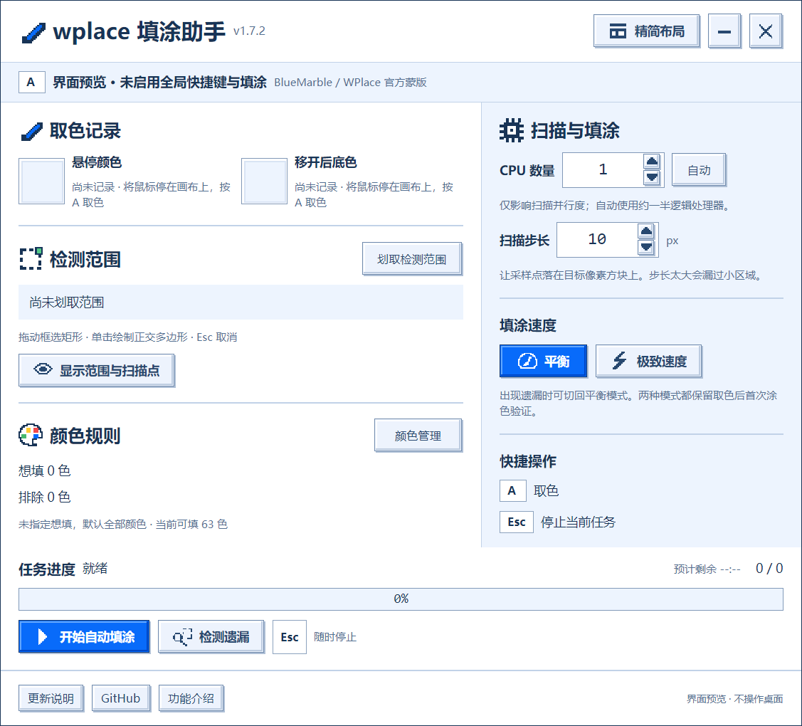
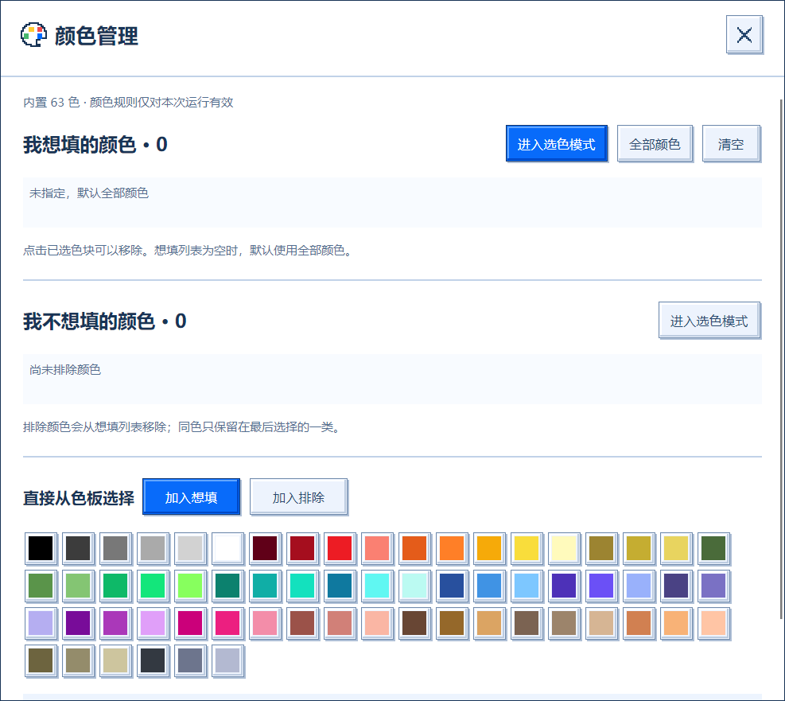
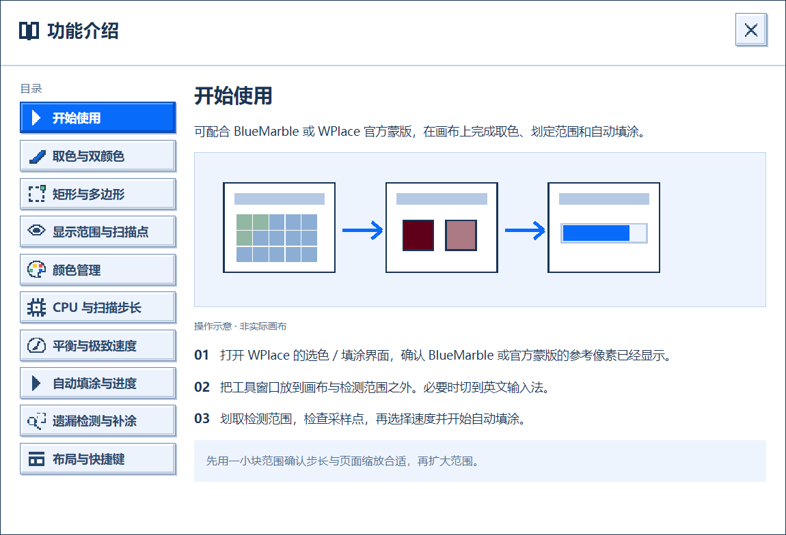

# wplace_canYouHelpMe

WPlace 填涂助手：配合 **BlueMarble 或 WPlace 官方蒙版**显示的参考像素，完成屏幕取色、范围选择、颜色筛选、自动填涂和遗漏检测。

当前版本 **1.7.2**，采用 Avalonia 像素风界面。发布包面向 **Windows x64**，自包含 .NET 运行时，解压后即可运行。

[查看已发布版本](https://github.com/Nooko331/wplace_canYouHelpMe/releases) · [反馈问题](https://github.com/Nooko331/wplace_canYouHelpMe/issues) · [开发与验证说明](Desktop/README.md)

## 新版界面

- **完整模式**集中展示双颜色、检测范围、颜色规则、CPU 数量、扫描步长、速度和任务进度。
- **精简模式**将常用操作收成一行，显示百分比和预计剩余时间；鼠标悬停或键盘聚焦可查看功能说明。
- **颜色管理**提供 63 色色板，支持直接选择、A 键连续取色、想填与排除规则。
- **功能介绍**提供目录、操作步骤和示例图，入口仅在完整模式。
- **更新说明**内置于程序，每个版本首次启动显示，也可从完整模式重新打开。
- **每次启动默认进入完整模式**，不记忆上次布局；CPU、步长和速度等偏好继续保存。

### 完整模式



### 精简模式


完整模式右上角点击“精简布局”即可切换；精简模式点击展开图标返回。

| 操作或信息 | 完整模式 | 精简模式 |
| --- | --- | --- |
| 双颜色、颜色管理、范围选择与显示 | 支持 | 支持 |
| 扫描步长、速度、开始填涂、遗漏检测 | 支持 | 支持 |
| CPU 数量与自动选择 | 可调整 | 沿用完整模式的设置 |
| 任务进度 | 已处理／总数、百分比、预计剩余时间 | 固定宽度的百分比和预计剩余时间 |
| 更新说明、GitHub、功能介绍 | 提供入口 | 不显示入口 |
| 停止当前任务 | Esc | Esc |

<details>
<summary>查看颜色管理、更新说明与功能介绍</summary>
### 颜色管理



### 更新说明


### 功能介绍



</details>

以上图片来自 1.7.2 实际程序的界面预览模式，未启用全局快捷键和填涂；功能介绍中的画布图为操作示意。

## 快速开始

1. 从 [Releases](https://github.com/Nooko331/wplace_canYouHelpMe/releases) 查看已发布版本，下载对应的 EXE 或 ZIP。ZIP 解压后运行其中的 EXE，无需另装 .NET。
2. 打开 WPlace 的选色／填涂界面，通过 BlueMarble 或官方蒙版显示参考像素。将工具窗口放到检测范围之外，确保画布无遮挡。
3. 将鼠标停在参考像素上，按 **A** 取色。主界面的两个色块会显示悬停颜色与移开鼠标后的底色。
4. 点击 **划取检测范围**，拖动选择矩形；需要不规则范围时，单击开始绘制正交多边形。
5. 打开 **显示范围与扫描点**，调整扫描步长，让采样点落在目标像素方块内。CPU 数量可点击“自动”；如需限制填涂颜色，先设置颜色管理。
6. 先使用 **平衡** 速度，点击 **开始自动填涂**。需要停止时按 **Esc**，任务结束后再调整范围或参数。

先用一小块范围确认页面缩放和步长，再扩大范围。程序运行时会控制鼠标与键盘；建议使用英文输入法，并保持画布位置及页面缩放不变。

## 功能说明

### 取色与双颜色

普通取色时，A 键会记录鼠标悬停颜色，临时移开鼠标等待底色稳定，然后调用网页的 `i` 键与鼠标左键取色动作。两个色块展示原始采样 RGB。

进入颜色管理的连续选色模式后，A 键只加入颜色规则，不发送网页取色点击。取色时请将鼠标停稳；无法确认颜色稳定或无法匹配色板时，按界面提示重试。

### 检测范围与扫描点

- **矩形**：按住左键拖动，松开确认。
- **正交多边形**：单击放下首个顶点，再逐点添加水平或垂直线段，回到起点闭合；右键撤销顶点。
- **取消选择**：按 Esc。选择直接作用于屏幕，程序不会另开内部地图。
- **点阵预览**：范围确定后，点击“显示范围与扫描点”。调整步长会实时更新点阵；隐藏预览不会清除检测范围。

取色和截图扫描时，红框、红点会暂时隐藏，避免进入采样；之后按当前任务状态恢复。预览只是辅助，不开启也可以填涂。

### 颜色管理

可直接点击内置色板，也可在“我想填的颜色”或“我不想填的颜色”中进入连续选色模式，在网页画布上按 A 添加颜色。

| 操作或状态 | 处理方式 |
| --- | --- |
| 想填列表为空 | 默认允许全部 63 色，再减去排除项 |
| 想填列表有颜色 | 只处理想填列表中的颜色 |
| 同一颜色加入另一组 | 自动从原来的组移除，两组不会重叠 |
| 全部颜色 | 选中全部 63 色，并清空排除列表 |
| 清空想填 | 清空显式选择，恢复“默认全部，再减去排除” |
| 点击已选色块 | 移除该颜色 |

颜色规则只对本次运行有效，重启后恢复默认。

### CPU、步长与填涂速度

**CPU 数量**只影响扫描并行度，不改变网页填涂按键的节奏。“自动”使用约一半逻辑处理器。该设置在完整模式调整。

**扫描步长**控制采样点间距。步长过大可能漏掉窄小区域，过小会增加扫描量；应结合页面缩放和点阵预览调整。

| 速度模式 | 用法 |
| --- | --- |
| 平衡 | 默认模式，先使用此模式确认页面响应稳定 |
| 极致速度 | 缩短填涂按键间隔；发生较多遗漏时，可停止后切回平衡 |

程序先扫描并按颜色归组，再根据颜色规则填涂。白色优先且整组免于涂色校验；非白色在每次取色后的首次涂色时验证，成功后连续处理同色点，失败时到下一点重新取色并验证。遗漏补涂沿用相同流程。

预计剩余时间根据当前阶段的进度估算，扫描与填涂阶段切换时会重新计算。

### 遗漏检测与补涂

完成正常填涂后，点击完整模式的 **检测遗漏**，或精简模式中对应的放大镜图标。检测只处理已选择的范围，不会在填涂结束后自动运行。

1. 开始前会显示使用建议，可选择“不再提示”。
2. 程序寻找小块遗漏候选点，并按颜色规则筛选。
3. 发现候选点后显示标记，再单独询问是否补涂；确认后才开始补涂。
4. 未发现候选点时显示检测结果，按配置附带诊断信息。

**“不再提示”只跳过开始前的建议，不会跳过补涂确认。** 遗漏检测用于寻找候选点，仍需结合画布检查结果。

### 功能介绍与窗口操作

完整模式底部的 **功能介绍**包含 10 个目录条目，可查看取色、范围、颜色规则、步长、速度、填涂、遗漏检测及快捷键说明。精简模式通过鼠标悬停浮窗查看按钮用途。

完整模式及弹窗可按住标题栏移动；精简模式可拖动左侧六点手柄或工具栏空白处。

| 快捷键 | 作用 |
| --- | --- |
| A | 普通状态下取色；颜色管理连续选色时加入规则 |
| Esc | 停止当前任务、取消范围选择、结束连续选色或关闭说明窗口 |
| 鼠标右键 | 绘制多边形时撤销顶点 |
| Tab / Shift+Tab | 切换控件焦点，精简模式可查看对应功能说明 |

编辑输入框或查看功能介绍、更新说明、确认窗口时，程序会避免全局取色快捷键干扰当前操作。

## 设置与更新

### 哪些内容会保存

| 内容 | 重启后的行为 |
| --- | --- |
| CPU 数量、扫描步长、速度、范围显示开关 | 恢复上次设置 |
| 遗漏检测的“不再提示” | 保留 |
| 完整／精简布局 | 始终进入完整模式，忽略旧版保存的布局 |
| 已选范围、想填与排除颜色 | 不保留 |
| 更新说明查看记录 | 同一版本已查看后不再自动显示 |

参数保存在 EXE 同目录的 `user_settings.json`。文件缺失或损坏时回退到默认值；需要重置全部参数时，可先退出程序，再移除该文件。

更新说明查看记录保存在：

```text
%LOCALAPPDATA%\wplace_canYouHelpMe\release_notes_state.json
```

### 更新说明与版本检查

**更新说明**离线内置，每版首次启动自动弹出；以后可从完整模式底部重新查看。

**版本检查**在正常启动后于后台访问 GitHub Releases。若本次显示了更新说明，会在关闭说明后开始检查。

- 发现更新：完整模式底部的“GitHub”入口变为“新版本 v…”，点击打开对应发布页。
- 未发现更新：保留“GitHub”项目入口。
- 检查失败：不打断填涂；悬停提示可查看发布页，点击后打开最新发布页。
- 软件不会自动下载或替换 EXE。精简模式不显示更新入口。

遇到连接问题，可直接打开 [最新发布页](https://github.com/Nooko331/wplace_canYouHelpMe/releases/latest)。排查时可提供 Windows 版本、代理使用情况，以及 EXE 同目录 `wplace_canYouHelpMe_error_log.txt` 中相关的 `[update]` 日志。

## 扫描与颜色匹配提示

扫描不到目标时，先检查范围、页面缩放、步长与颜色规则，并确认工具窗口或其他窗口没有挡住画布。

程序保留原有 63 色及一组半透明显示色匹配。该组显示色基于 **50% 不透明度叠加在 `#F8F4F0` 底色上**的兼容假设，具体见 [63 色半透明对应表](docs/半透明色板_50percent.md)。更换蒙版透明度或显示方式可能影响识别，不能据此保证任意蒙版设置都能匹配。

<details>
<summary>高级：遗漏检测参数</summary>

遗漏检测按交错点阵的六邻接关系聚类，将被非匹配点包围的小簇作为候选，并按条件检查外围是否有同色大簇。以下参数可在启动时通过命令行调整：

| 参数 | 默认值 | 作用 |
| --- | --- | --- |
| `--island-color-tol` | 10 | 遗漏检测的原色匹配容差 |
| `--island-max-size` | 5 | 候选小簇的点数上限 |
| `--island-moat-ratio` | 0.5 | 小簇紧邻外环中非匹配点的最低占比 |
| `--island-strong-moat-ratio` | 0.9 | 达到此占比时跳过外围大簇要求 |
| `--island-min-outer-multiplier` | 3.0 | 外围同色大簇相对候选簇的最小点数倍数 |
| `--island-search-radius` | 6 | 外围搜索半径，单位为网格层数 |
| `--island-require-outer-big` | true | 是否要求存在外围同色大簇 |

例如，在 EXE 所在目录执行：

```powershell
.\wplace_canYouHelpMe_Avalonia_v1.7.2.exe --island-color-tol 15 --island-max-size 5
```

普通扫描的 `--color-tol` 默认为 0；半透明显示色只接受内置计算值及取整，不额外叠加容差。

</details>

## 开发与打包

源码运行需要 **Windows 和 .NET 10 SDK**。Avalonia 界面位于 `Desktop/`，通过 `WindowsEngineHost` 调用原有 Windows 取色、扫描和填涂内核。原 WinForms 工程保留为 1.6.4；当前桌面应用的启动和发布入口是 `Desktop/Wplace.Desktop.csproj`。

所有命令均在仓库根目录的 PowerShell 中执行：

```powershell
# 正常运行，启用原有功能
dotnet run --project .\Desktop\Wplace.Desktop.csproj -c Release

# 仅预览界面，不启用屏幕读取、全局快捷键、填涂或网络检查
dotnet run --project .\Desktop\Wplace.Desktop.csproj -c Release -- --preview-ui

# 构建
dotnet build .\Desktop\Wplace.Desktop.csproj -c Release

# 发布自包含 EXE 和 ZIP
.\Desktop\Publish.ps1
```

发布脚本优先使用工作区的 `artifacts/dotnet10/dotnet.exe`，没有时使用 PATH 中的 `dotnet`。1.7.2 的输出为：

```text
publish/avalonia-v1.7.2/wplace_canYouHelpMe_Avalonia_v1.7.2.exe
publish/wplace_canYouHelpMe_Avalonia_v1.7.2_win-x64.zip
```

ZIP 仅包含 EXE，不包含用户设置、日志或更新说明查看记录。脚本拒绝覆盖已有同名 ZIP；本地仅重建 EXE 可使用 `-SkipZip`，分发时应重新核对 ZIP 与 EXE 是否一致。

### 维护版本与更新说明

1. 编辑 [Desktop/ReleaseNotes.txt](Desktop/ReleaseNotes.txt)，维护本版用户可见的更新说明。
2. 同步 [Desktop/Wplace.Desktop.csproj](Desktop/Wplace.Desktop.csproj) 中的 `Version`、`FileVersion`、`AssemblyVersion`，以及 [Desktop/Program.cs](Desktop/Program.cs) 中的 `Version`，再更新 README。
3. 重新打包并预览实际 EXE。说明嵌入程序，修改文本后已生成的 EXE 不会自动变化。

```powershell
.\publish\avalonia-v1.7.2\wplace_canYouHelpMe_Avalonia_v1.7.2.exe --preview-release-notes
```

预览模式不写入真实查看记录。同一版本只修改说明不会让已查看的用户再次自动看到弹窗；正式发布新说明时应递增版本。GitHub 更新检测读取已发布的 Release 标签，版本标签使用 `v1.7.2` 这类格式。

### 验证

```powershell
# Windows 内核桥接与设置行为
dotnet run --project .\tests\Desktop\Desktop.IntegrationTests.csproj -c Release

# 检查实际发布 EXE 的页面和控件交互，输出截图与检查结果
.\publish\avalonia-v1.7.2\wplace_canYouHelpMe_Avalonia_v1.7.2.exe --capture "$PWD\artifacts\avalonia-review"
```

1.7.2 打包验证（2026-10-15）：**24/24 项内核桥接检查、30/30 项界面与交互检查通过**，并核对了版本信息和 ZIP 内外 EXE 哈希。桥接检查使用受控画布；界面检查使用只读模式。尚未在实际 WPlace 页面完成本版完整填涂及多显示器现场验收。

其他回归测试、架构与历次验证记录见 [Avalonia 桌面版说明](Desktop/README.md)。

## 许可证

本项目采用 [Mozilla Public License 2.0](LICENSE.txt)。
